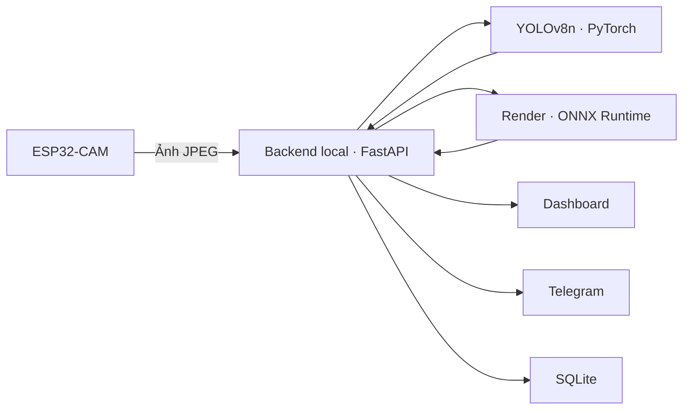

# Lab 2 — Hệ thống IoT nhận diện khẩu trang

**Nhóm 12**

Bài lab xây dựng hệ thống nhận diện khẩu trang từ ảnh của ESP32-CAM. Model
YOLOv8n xác định vị trí từng khuôn mặt và phân loại trạng thái đeo khẩu trang.
Kết quả được hiển thị trên dashboard, gửi qua Telegram và lưu cùng số đo độ trễ.
Hệ thống hỗ trợ suy luận trên máy tính hoặc trên cloud Render.

## 1. Mục tiêu

- Thu nhận ảnh từ ESP32-CAM qua Wi-Fi.
- Huấn luyện model nhận diện ba trạng thái khẩu trang.
- Nhận diện nhiều khuôn mặt trong cùng một ảnh và vẽ bounding box.
- Xây dựng dashboard để chụp ảnh, xem Live và kiểm tra kết quả.
- Gửi ảnh nhận diện qua Telegram.
- Xuất model thành một file ONNX để triển khai cloud.
- Đo thời gian suy luận, thời gian phản hồi và thời gian chờ toàn trình.

## 2. Các nhãn nhận diện

| ID | Class | Ý nghĩa |
|---:|---|---|
| 0 | `with_mask` | Đeo đúng: che kín mũi và miệng |
| 1 | `without_mask` | Không đeo khẩu trang |
| 2 | `mask_weared_incorrect` | Đeo sai: hở mũi/miệng, kéo xuống cằm hoặc treo một bên tai |

Confidence hiển thị cạnh mỗi box là độ tin cậy của dự đoán, không phải độ chính
xác tổng thể của model. Chất lượng model được đánh giá bằng Precision, Recall
và mAP trên tập dữ liệu đánh giá riêng.

## 3. Kiến trúc hệ thống



Backend local lấy ảnh từ camera, chuyển ảnh tới nơi suy luận được chọn rồi trả
box, nhãn, confidence và ảnh đã nhận diện cho dashboard. Camera và laptop cần
kết nối cùng mạng. Trong chế độ cloud, laptop gửi ảnh tới Render qua HTTPS.

| Thành phần | Công nghệ | Vai trò |
|---|---|---|
| Thiết bị | ESP32-CAM AI Thinker | Chụp ảnh, cung cấp ảnh JPEG, điều khiển flash |
| Model | YOLOv8n | Phát hiện khuôn mặt và phân loại khẩu trang |
| Backend local | Python, FastAPI, PyTorch, OpenCV | Kết nối camera, chạy model, trả kết quả |
| Cloud | Render, Docker, ONNX Runtime CPU | Chạy suy luận với model ONNX |
| Dashboard | HTML, CSS, JavaScript | Hiển thị ảnh, nhãn, thống kê và độ trễ |
| Lưu trữ | SQLite | Lưu số mặt theo nhãn và các số đo của mỗi lượt |
| Thông báo | Telegram Bot API | Gửi ảnh và kết quả nhận diện |

## 4. Chức năng

- **Chụp + nhận diện:** lấy một ảnh từ camera, vẽ box, giữ nguyên kết quả và gửi
  chính ảnh đã nhận diện lên Telegram.
- **Live nhận diện:** liên tục lấy ảnh mới và cập nhật box trên từng frame.
- **Xem ảnh:** dừng Live và giữ ảnh đang xem để kiểm tra nhãn.
- **Bật/Tắt flash:** điều khiển đèn trên ESP32-CAM.
- **Lưu ảnh gốc:** tải ảnh của frame đang xem trước khi vẽ box.
- **Kiểm thử ảnh:** tải JPEG/PNG từ máy lên để chạy model.
- **Máy tính / Cloud Render:** chọn nơi xử lý ảnh.
- **Thống kê:** hiển thị số mặt đeo đúng, không đeo, đeo sai và kết quả từng lượt;
  xuất dữ liệu CSV.
- **Cảnh báo Telegram:** Live gửi cảnh báo khi có nhãn không đeo/đeo sai theo
  khoảng cách gửi đã cấu hình.

Số liệu được cộng theo lượt nhận diện. Một người xuất hiện trong nhiều frame
Live được tính nhiều lần; đây không phải chức năng đếm người duy nhất.

## 5. Cấu trúc project

```text
Lab2_FaceMask/
├── esp32_cam/       # Firmware và cấu hình ESP32-CAM
├── server/          # Backend local, API cloud, model và Telegram
├── web/             # Dashboard
├── scripts/         # Xử lý dữ liệu, train, evaluate và cấu hình cloud
├── data/            # Dữ liệu ảnh, nhãn YOLO và SQLite
├── models/          # Checkpoint PyTorch và model ONNX
├── cloud/render/    # Dockerfile và cấu hình triển khai Render
├── docs/            # Tài liệu kỹ thuật
└── requirements.txt
```

## 6. Chạy trên máy tính

### Chuẩn bị môi trường

Cần Python 3.12, Arduino IDE và board package ESP32. Trong terminal PowerShell:

```powershell
# Máy mới: tải repository đầy đủ rồi mở thư mục vừa clone.
git clone https://github.com/moseking/IoT_ComputerVision_Lab2_Nhom12.git
cd IoT_ComputerVision_Lab2_Nhom12
py -3.12 -m venv .venv
.\.venv\Scripts\python.exe -m pip install -r requirements.txt
```

Nếu chưa có `.env`, tạo từ `.env.example`:

```powershell
if (-not (Test-Path .env)) { Copy-Item .env.example .env }
```

Cấu hình các biến chính trong `.env`:

| Biến | Nội dung |
|---|---|
| `MODEL_PATH` | Đường dẫn tới checkpoint đã train, ví dụ `models/camera_v7/face_mask_best.pt` |
| `ESP32_CAMERA_URL` | URL camera đọc từ Serial Monitor |
| `DEVICE` | `auto` hoặc `cpu` |
| `IMAGE_SIZE` | Kích thước suy luận, mặc định dùng `512` trong cấu hình mẫu |
| `CONFIDENCE_THRESHOLD` | Ngưỡng confidence, ví dụ `0.35` |
| `LATENCY_DB_PATH` | Đường dẫn file SQLite |

### Chạy trên máy của thành viên nhóm

Repository có checkpoint đã train và dashboard; không cần dataset hay train lại
để chạy nhận diện. Sau khi cài thư viện và tạo `.env`, có thể khởi động backend,
chọn **Máy tính** và gửi ảnh JPEG/PNG để kiểm thử ngay, kể cả khi chưa có camera.
Máy không có GPU vẫn chạy được với `DEVICE=cpu`.

Để chụp hoặc xem Live, máy của thành viên phải truy cập được IP ESP32-CAM và
điền IP hiện tại vào `ESP32_CAMERA_URL`. Nếu cùng dùng một board đã nạp đúng
firmware và cùng mạng thì không cần nạp lại. Nếu dùng board khác, làm theo bước
cấu hình ESP32-CAM bên dưới.

Telegram cần token/chat ID riêng trong `.env`; Render cần URL và shared key của
service nhóm. Các giá trị này trao đổi riêng trong nhóm, không nằm trong GitHub.
Chỉ một backend nên bật `TELEGRAM_COMMANDS_ENABLED=true` với cùng bot để tránh
các máy cùng nhận lệnh; máy còn lại đặt biến này thành `false`.
SQLite được tạo trên từng máy khi chạy, nên các lượt nhận diện trên máy khác
không tự đồng bộ. Dataset không nằm trong repository; muốn train lại cần chép
riêng dữ liệu và nhãn đã xác minh.

### Cấu hình ESP32-CAM

1. Tạo `esp32_cam/config.h` từ `esp32_cam/config.h.example` nếu chưa có.
2. Điền tên và mật khẩu Wi-Fi 2.4 GHz.
3. Đặt `INFERENCE_ENABLED=false` để dashboard chủ động lấy ảnh khi chụp hoặc Live.
4. Mở `esp32_cam/esp32_cam.ino`, chọn board **AI Thinker ESP32-CAM** và đúng cổng COM.
5. Upload firmware, reset board rồi đọc địa chỉ IP trong Serial Monitor.
6. Điền IP vào `ESP32_CAMERA_URL` hoặc ô Camera URL trên dashboard.

### Khởi động backend

```powershell
.\.venv\Scripts\python.exe -m uvicorn server.main:app --host 0.0.0.0 --port 8000
```

Mở dashboard tại `http://127.0.0.1:8000`. Tài liệu API nằm tại `/docs` và trạng
thái model tại `/health`. Model cần được nạp thành công trước khi nhận diện local.

## 7. Dữ liệu và huấn luyện

Dữ liệu gồm bộ Face Mask Detection và ảnh tự thu thập bằng điện thoại/ESP32-CAM.
Nhãn Pascal VOC XML được chuyển sang YOLO; ảnh bổ sung được kiểm tra class và
bounding box trước khi đưa vào train. Box của trường hợp đeo sai cần bao quát
cả khuôn mặt và phần khẩu trang liên quan.

Chia dữ liệu train/validation/test để đánh giá riêng. Ảnh đã dùng train không
được coi là mẫu kiểm thử độc lập. Có thể fine-tune từ trọng số YOLO pretrained.

Ví dụ train với bộ dữ liệu đã chuẩn bị:

```powershell
.\.venv\Scripts\python.exe scripts/train.py --data data/processed/facemask_camera_v7/data.yaml --pretrained --epochs 30 --imgsz 512 --batch 8 --workers 0 --device auto --run-name lab2_facemask --no-publish
```

Checkpoint tốt nhất được chọn theo validation và lưu trong thư mục của run.
Sau đánh giá, chọn checkpoint dùng cho `MODEL_PATH`. Bản chạy cloud sử dụng file
`models/cloud_v7/face_mask_v7.onnx` đã xuất từ checkpoint của bài lab.

## 8. Telegram

Đặt `TELEGRAM_ENABLED=true`, `TELEGRAM_BOT_TOKEN` và `TELEGRAM_CHAT_ID` trong
`.env`. `TELEGRAM_COOLDOWN_SECONDS` quy định khoảng cách gửi cảnh báo Live;
`TELEGRAM_ALERT_MODE=violations` chỉ cảnh báo khi có người không đeo hoặc đeo sai.
Nút **Chụp + nhận diện** yêu cầu gửi ảnh đang chụp dù kết quả thuộc nhãn nào.

## 9. Triển khai Render

Repository đầy đủ gồm mã nguồn local, firmware, dashboard, công cụ train và
model. Dockerfile ở thư mục gốc chỉ đóng gói API cloud ONNX để chạy trên Render.
Chuẩn bị mã nguồn đưa lên GitHub và shared key:

```powershell
.\.venv\Scripts\python.exe scripts/prepare_repository.py
.\.venv\Scripts\python.exe scripts/configure_cloud.py --init-key
```

Đưa nội dung `.runtime/deployment/full_lab2/source` lên repo GitHub. Snapshot
này chứa mã nguồn cùng checkpoint local và model ONNX; `.env`, Wi-Fi config,
môi trường Python, dataset ảnh và SQLite giữ trên máy. Trên Render,
tạo Web Service từ repo và chọn **Docker**, **Free**, Dockerfile `./Dockerfile`,
health check `/health`. Đặt `CLOUD_API_KEY` và `CLOUD_MODEL_SHA256` theo file
`.runtime/cloud/render_secrets.env` trên máy.

Khi service sẵn sàng, cấu hình URL của Render:

```powershell
.\.venv\Scripts\python.exe scripts/configure_cloud.py --url https://TEN-SERVICE.onrender.com
```

Khởi động lại backend local, tải lại dashboard và chọn **Cloud Render**. Ảnh được
gửi từ laptop tới cloud; dashboard và camera vẫn dùng kết nối local. File model
nằm trong Docker image. SQLite và chức năng Telegram chạy trên laptop.

## 10. Đo độ trễ và kiểm thử

| Số đo | Phạm vi |
|---|---|
| Model inference | Preprocess + model + NMS tại nơi suy luận |
| Round trip cloud | Laptop bắt đầu gửi ảnh tới Render → nhận hết response |
| End-to-end | Dashboard yêu cầu chụp/test → nhận hết kết quả, gồm bước lấy ảnh và xử lý |

`capture_ms` chỉ có giá trị khi thiết bị cung cấp thời gian lấy frame thực tế.
Thời gian gọi `/capture` qua mạng được hiển thị riêng, không thay cho `capture_ms`.

Khi demo, kiểm tra ba trạng thái khẩu trang, ảnh có một/nhiều mặt, flash, Telegram
và chế độ local/cloud. Đối chiếu box, nhãn và confidence với ảnh đang xem; xuất
CSV để tổng hợp số liệu. Độ chính xác phụ thuộc dữ liệu huấn luyện, ánh sáng,
góc camera, kích thước mặt và cách đeo khẩu trang.
