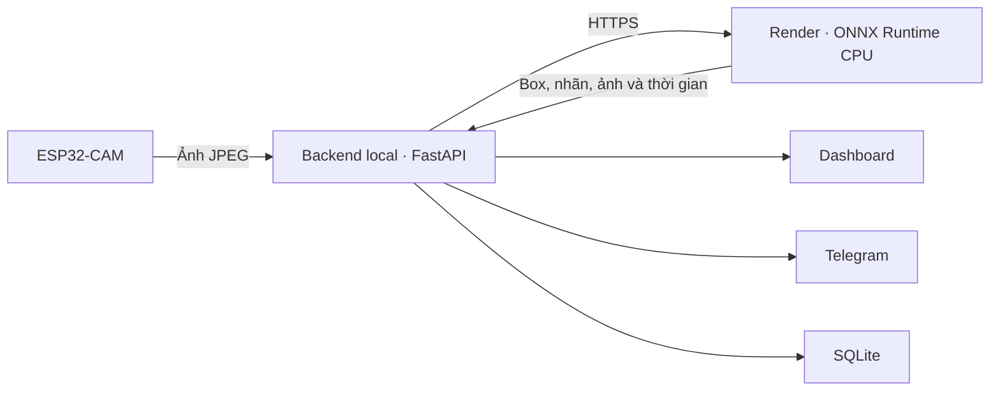

# Lab 2 — Hệ thống IoT nhận diện khẩu trang

**Nhóm 12**

Bài lab sử dụng ESP32-CAM và YOLOv8n để nhận diện trạng thái đeo khẩu trang,
hiển thị kết quả trên dashboard, gửi ảnh qua Telegram và đo độ trễ của hệ thống.
Repository này chứa **API suy luận cloud và model ONNX** để triển khai Render.
Firmware, dashboard, công cụ xử lý dữ liệu và train nằm trong project local
`Lab2_FaceMask`.

## Mục tiêu

- Thu nhận ảnh từ ESP32-CAM qua Wi-Fi.
- Nhận diện từng khuôn mặt, vẽ bounding box và phân loại ba trạng thái khẩu trang.
- Xuất model thành một file để chạy trên cloud.
- Hiển thị nhãn, confidence, số khuôn mặt và thống kê kết quả.
- Gửi ảnh nhận diện qua Telegram.
- Đo thời gian suy luận, phản hồi local–cloud và thời gian chờ toàn trình.

## Nhãn nhận diện

| ID | Class | Ý nghĩa |
|---:|---|---|
| 0 | `with_mask` | Đeo đúng: che kín mũi và miệng |
| 1 | `without_mask` | Không đeo khẩu trang |
| 2 | `mask_weared_incorrect` | Đeo sai: hở mũi/miệng, kéo xuống cằm hoặc treo một bên tai |

Confidence là độ tin cậy của từng dự đoán. Precision, Recall và mAP được dùng
để đánh giá chất lượng model trên dữ liệu đánh giá riêng.

## Kiến trúc



Backend local lấy ảnh từ camera trong mạng Wi-Fi rồi gửi ảnh tới Render.
Cloud chạy model, vẽ box và trả kết quả. Dashboard hiển thị ảnh đã nhận diện;
backend local lưu thống kê, số đo và xử lý gửi Telegram.

## Công nghệ

| Thành phần | Công nghệ |
|---|---|
| Camera | ESP32-CAM AI Thinker |
| Model | YOLOv8n, ONNX FP32 |
| API cloud | Python 3.12, FastAPI, OpenCV, ONNX Runtime CPU |
| Triển khai | Docker, Render |
| Ứng dụng local | FastAPI, PyTorch, HTML/CSS/JavaScript |
| Thông báo và lưu kết quả | Telegram Bot API, SQLite |

## Chức năng của bài lab

- **Chụp + nhận diện:** chụp một ảnh, giữ nguyên box/nhãn và gửi ảnh qua Telegram.
- **Live nhận diện:** cập nhật ảnh và box liên tục.
- **Xem ảnh:** dừng Live để kiểm tra kết quả đang hiển thị.
- **Flash:** bật/tắt đèn của camera.
- **Kiểm thử ảnh:** nhận JPEG/PNG từ máy tính.
- **Local / Cloud:** chọn nơi suy luận trên dashboard.
- **Thống kê:** số mặt đeo đúng, không đeo, đeo sai, kết quả từng lượt và xuất CSV.

Số liệu cộng theo lượt nhận diện, không phải số người duy nhất trong các frame Live.

## Cấu trúc repository

```text
├── server/
│   ├── cloud_app.py          # API suy luận cloud
│   ├── cloud_entry.py        # Khởi động Uvicorn trên PORT của Render
│   ├── cloud_bootstrap.py    # Kiểm tra file model và SHA-256
│   ├── inference_onnx.py     # Preprocess, ONNX inference và NMS
│   └── inference.py          # Giải mã ảnh và vẽ kết quả
├── models/
│   ├── face_mask_v7.onnx     # Một file model đã xuất
│   └── model_manifest.json
├── Dockerfile
├── requirements.txt
└── render.yaml
```

## Triển khai trên Render

1. Đưa nội dung repository lên GitHub.
2. Render → **New → Web Service**, chọn repo tương ứng.
3. Chọn **Docker**, branch `main`, instance **Free**, Root Directory để trống
   và Dockerfile Path `./Dockerfile`.
4. Đặt Health Check Path là `/health`.
5. Thêm hai biến môi trường:

| Biến | Giá trị |
|---|---|
| `CLOUD_API_KEY` | Shared key trùng với backend local, tối thiểu 24 ký tự |
| `CLOUD_MODEL_SHA256` | SHA-256 của file ONNX, lấy từ `models/model_manifest.json` |

6. Deploy và kiểm tra `/health` trả `model_loaded: true`.
7. Trong project local, đặt URL HTTPS vào `CLOUD_API_URL`, dùng cùng
   `CLOUD_API_KEY` và `CLOUD_MODEL_SHA256`; khởi động lại backend.
8. Mở dashboard local và chọn **Cloud Render** để chạy nhận diện.

Model được đóng gói sẵn trong Docker image. API cloud xử lý ảnh trong bộ nhớ;
thống kê SQLite và gửi Telegram được thực hiện ở backend local.

## API

| Method | Endpoint | Chức năng | Xác thực |
|---|---|---|---|
| GET | `/health` | Trạng thái model | Không |
| GET | `/model/info` | Model, class, cấu hình và SHA-256 | `X-API-Key` |
| POST | `/predict` | Nhận ảnh và trả kết quả | `X-API-Key` |

`POST /predict` nhận multipart field `file`. Ảnh JPEG/PNG tối đa 5 MiB và
4 triệu pixel. Response gồm nhãn, confidence, bounding box, ảnh đã vẽ,
SHA-256 model/ảnh đầu vào và thời gian xử lý.

Cloud xử lý một request nhận diện tại một thời điểm; request đồng thời nhận
HTTP 429 và có thể thử lại. Cấu hình suy luận: kích thước `512`, confidence
`0.35`, NMS class-agnostic với IoU `0.45`.

## Đo độ trễ

| Số đo | Phạm vi |
|---|---|
| Inference cloud | Preprocess + ONNX model + NMS trên Render |
| Round trip | Laptop bắt đầu POST ảnh → nhận hết response cloud |
| End-to-end | Dashboard yêu cầu chụp/test → nhận hết kết quả |

Số đo cloud cần lấy từ các request HTTPS thực tế. Khi demo, kiểm tra ảnh một/
nhiều mặt và cả ba trạng thái khẩu trang, sau đó đối chiếu box và nhãn trên ảnh.
Chất lượng nhận diện phụ thuộc dữ liệu train, ánh sáng, góc chụp và độ rõ của mặt.
