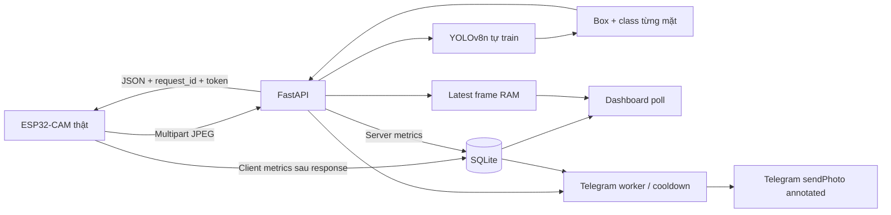

# Kiến trúc Lab 3



Offline: VOC → audit → grouped train/val/test YOLO → train → weights/metadata → test evaluation.
Detector học box khuôn mặt và nhãn khẩu trang; nhiều mặt có nhiều box/class độc lập.

## Vòng đời

Lifespan mở SQLite và load checkpoint một lần. Không tự tải COCO detector để đoán khẩu trang.
Thiếu model: UI vẫn chạy, health model_unavailable, predict503.
Lock bảo vệ predictor; perf_counter đo monotonic và CUDA synchronize khi có CUDA.
Queue tách khỏi inference. Decode PIL kiểm tra định dạng/pixel limit rồi OpenCV vẽ/encode.
Middleware giới hạn toàn body kể cả chunked trước khi multipart parse.

SQLite WAL, connection ngắn mỗi operation, request_id unique.
Report token ngẫu nhiên, retry idempotent. API_KEY bảo vệ dữ liệu khi bật.
Chỉ một worker được hỗ trợ: nhiều worker cần shared cache thay latest RAM và cân nhắc GPU memory.
Latest RAM chỉ một frame; DB giữ số đo, không lưu lịch sử ảnh người.

## Clock và định nghĩa đo

ESP32 cùng clock esp_timer:
t0 capture start; t1 lấy/copy JPEG xong; t2 request start; t3 POST nhận headers;
t4 đọc hết response body.

- capture=t1-t0, roundtrip=t4-t2, total=t4-t0.
- download=t4-t3 là body-read sau headers, có thể đã buffered.
- upload=null vì HTTPClient.POST gộp upload/chờ server/nhận headers.
- Multipart preparation thuộc total; Serial/JSON parse/metrics report sau t4 nằm ngoài total.
- Framebuffer chạy liên tục; capture là acquisition/copy, không riêng sensor exposure.

Server inference gồm preprocess/model/NMS; queue/decode/vẽ/mạng tách khỏi inference.
Processing gồm file read/decode/inference/vẽ, chưa DB/serialize/transfer.
RTT-processing là residual ước lượng có cả TCP/TLS/mạng/serialize; không gọi là one-way upload.
Không trừ timestamp khác máy nếu chưa kiểm chứng clock sync.
Metrics client chỉ biết sau response; report mất thì null, không bịa số.

## Leakage và dữ liệu

Raw không sửa. Pixels SHA256 phát hiện duplicates cả khác encoding.
Near duplicates dHash<=4 gom nhóm transitive. Nhãn mâu thuẫn chỉ loại cả nhóm khi chọn policy exclude.
Split seeded/cân bằng lớp theo nhóm; không augmentation trước split.
Manifest lưu hash/lớp/ảnh bị loại. Test không dùng chọn checkpoint.
DHash là heuristic; không có person IDs thì không bảo đảm identity-disjoint.
Với cùng người/video/phiên chụp phải cung cấp --groups.

## Chuyển cloud

Deploy cùng FastAPI/web, mount checkpoint+metadata và SQLite persistent.
Đổi API_BASE_URL trong .env, SERVER_URL/METRICS_URL firmware, cấu hình TLS_ROOT_CA và API_KEY,
compile/upload lại. Camera thật vẫn gửi ảnh lên server, model không nhúng vào ESP32.

Docker mẫu sau khi đã train:

```powershell
docker build -t face-mask-iot .
docker run --rm -p 8000:8000 --env-file .env -v "${PWD}/models:/app/models:ro" -v face-mask-latency:/app/data face-mask-iot
```

Image mặc định CPU; cloud GPU cần runtime/CUDA đúng provider.
YAML dataset dùng absolute Windows path; train máy khác cần prepare lại.
Cloud inference không cần raw dataset. API_BASE_URL phải hostname cloud, không giữ127.0.0.1.
Nếu UI khác origin, đặt CORS_ORIGINS chính xác.
HTTPS ở reverse proxy/platform, TLS hợp lệ, API key/rate limits phù hợp.
Chưa publish cloud. Số đo LAN không mô tả là local↔cloud.

## Đối chiếu slide

Lab3 yêu cầu lightweight model, xuất model, ba nhãn đồng thời, giao diện và ba loại latency.
Teachable Machine trong slide là ví dụ hỗ trợ; yêu cầu của bạn chọn tự train YOLOv8n.
Telegram là yêu cầu bổ sung của bạn; backend kế thừa lệnh và cooldown từ Lab 2 cũ. Xem TELEGRAM.md.

Nguồn: [Dataset Kaggle](https://www.kaggle.com/datasets/andrewmvd/face-mask-detection),
[YOLOv8](https://docs.ultralytics.com/models/yolov8/),
[metrics](https://docs.ultralytics.com/reference/utils/metrics/),
[CameraWebServer Espressif](https://github.com/espressif/arduino-esp32/tree/master/libraries/ESP32/examples/Camera/CameraWebServer).

## Dữ liệu bổ sung ngày 2026-10-11

HEIC/JPEG phone → đọc codec/EXIF và JPEG processed → YuNet draft boxes → local human review → manifest verified → versioned baseline builder. Public val/test đóng băng; custom human verified cùng nhóm chụp chỉ train. Baseline v1 khởi tạo COCO YOLOv8n theo phép fine-tune đã được giảng viên cho phép; inference chỉ sử dụng model face-mask đã train. Camera/multi-person độc lập và không train từ draft. Checkpoint chọn bằng validation; test không dùng tuning. Xem BASELINE_RUNBOOK.md.
